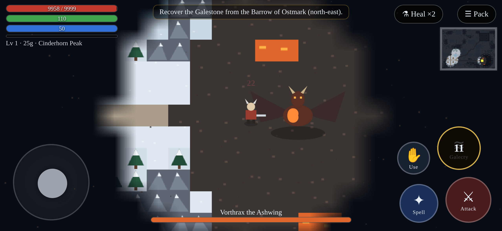

# Frosthold: Galecry

A snowy action-RPG vertical slice built for **Safari on iPhone 15**. It also runs in any modern browser. Everything is plain HTML5 canvas and vanilla JS modules, with no build step and no downloaded assets: the art is drawn in code and the sound is synthesized with WebAudio. The world and all names are original.

**Play:** https://ogcheeto.github.io/skyrim-iphone/



## Playing on iPhone
1. Open the link above in **Safari**.
2. Rotate the phone to **landscape**.
3. For fullscreen, tap **Share → Add to Home Screen**, then launch *Frosthold* from the icon.
4. Tap **New Journey** and choose *Shieldborn Warrior*, *Rimecaller Mage*, or *Veilstep Rogue*.

The game saves to localStorage on its own: on quest changes, level-ups, and chests, every 30 s, and when the app goes to the background. You can also save manually in **Pack → Character → Save game**. Saves are tied to the device and browser. The home-screen app keeps its storage separate from Safari.

## Controls
| Touch | Keyboard | Action |
|---|---|---|
| Left joystick | WASD / arrows | Move |
| ⚔ Attack (hold) | J / Space | Melee swing (uses stamina) |
| ✦ Spell (hold) | K | Frost bolt (uses magicka; a mage's bolts pierce) |
| ≋ Galecry | L / Q | **Signature shout.** A storm cone that damages, knocks back, and stuns enemies and blows away enemy fire. It has a cooldown. |
| ✋ Use | E | Talk, open chests, take items |
| ⚗ Heal | — | Drink a health potion |
| ☰ Pack | I | Inventory / Journal / Character (save and load) |

## What to try first
1. Talk to **Elder Maren** (purple, with a "!") in Kettleford to start the main quest, *The Ashwing Wakes*.
2. Talk to **Hunter Brannoc** to start the side quest, *Teeth in the Snow*: slay 5 frost wolves.
3. Follow the road north-east (up and right) to the **Barrow of Ostmark**. Fight past the Hollow Wights, take the glowing Galestone, and loot the chests.
4. Bring the stone back to Maren. This **empowers Galecry**: more damage, longer range, and a shorter cooldown.
5. Buy potions from **Ilsa** or sell her your loot. Equip better gear from the Pack.
6. Go south-east to **Cinderhorn Peak** and fight **Vorthrax the Ashwing**. He breathes fans of fire, so use Galecry to blow it away. Below half health he becomes enraged.

Fog of war covers the map and lifts as you explore. A minimap sits in the top right.

## Running locally
```bash
python3 -m http.server 8000   # open http://localhost:8000
node test/core.test.mjs       # logic tests: world reachability, quests, leveling, items, fog, save round-trip
```
`test/smoke.playwright.mjs` is a headless-Chrome smoke test that runs at iPhone 15 landscape size (852×393). It needs `playwright-core`, Chrome, and a server on port 8765.

## Layout
- `index.html`, `style.css`: HUD, touch controls, menus, safe-area insets
- `js/core.js`: pure logic (world generation, classes, loot, quests, XP, save format)
- `js/game.js`: game loop, rendering, combat, AI, input, menus
- `js/audio.js`: procedural WebAudio sound effects
- `manifest.webmanifest`, `icon*`: Add to Home Screen support

## Audio

All sound is generated in real time with WebAudio. The game ships no audio files.

- **Ambience:** wind made from filtered noise, with gusts that vary by region. They are calm in Kettleford and strongest on Cinderhorn Peak. Near the dragon's lair an ash and fire rumble fades in. The wind drops inside the ruins.
- **Combat music:** a slow taiko and war-drum loop. It fades in when enemies are engaged or within reach, and fades out about 4 s after a fight ends. The dragon fight crossfades to a faster, denser variant.
- **Mix:** separate SFX, music, and ambience buses feed a master gain and a limiter, so nothing clips. Music sits under the SFX.
- **iOS:** audio starts on the first tap. It suspends when the page goes to the background and resumes when it comes back.
- **Settings:** Menu → Character → Audio has Music and Ambience volume sliders and mute toggles. They are saved in localStorage under `frosthold.audio.v1`.
- **Performance:** noise buffers are made once and looped. Drums use a 50 ms lookahead scheduler.

Tests: `node test/core.test.mjs && node test/audio.test.mjs && node test/weather.test.mjs`. For the headless check, serve on :8765 and run `test/audio.playwright.mjs` with playwright-core.

## Weather

Logic is in `js/weather.js`: pure functions plus small classes, with no DOM, so it can be unit-tested.

- **States:** Clear, Windstorm, Snowstorm and Rainstorm. Each region picks one at random using its own odds. Kettleford is mostly clear, and the peaks are stormy. A new state is picked on entering a region and every 2–4 minutes, with an 8 s crossfade. The current state is shown in the HUD after the region name.
- **Visuals:** a fixed pool of 240 particles is allocated once and reused. Snow is drawn as flakes; rain is drawn as short angled streaks in a single batched path. Storm gloom is one translucent tint. During rainstorms there is a white lightning flash that decays in about 0.18 s, at least 6 s apart, so it never strobes.
- **Wind push:** in storms, gusts ramp slowly (time constant about 1.5 s) to a small sideways push. The maximum push is 30 px/s on Cinderhorn Peak, 24 in the Highlands, 14 in Whitepass Vale and 12 at the Barrow. The hard cap of 30 px/s is under 25% of the slowest class's speed. The push is **zero in Kettleford, inside the ruins, and during the dragon fight**. The dragon fight was a deliberate choice to keep the boss fair.
- **Projectiles:** frost bolts and the dragon's fire drift with the wind, at 2.5× the player's push. In practice the dragon's fire never drifts, because there is no wind during the boss fight.
- **Audio:** in storms the wind gets louder and gustier. Rainstorms add a procedural rain-hiss layer. Both are on the ambience bus, so the Ambience volume slider and mute apply to them.
- **FPS safety valve:** if the smoothed FPS stays below 45 for 1 s, the particle budget drops by 25%, down to a minimum of 60. When FPS stays above 55 for 3 s, it climbs back up.
- **Saves:** weather is not saved; it is re-rolled on load. Save and load are otherwise unchanged.

Tests: `node test/weather.test.mjs`. For the headless check, run `test/weather.playwright.mjs`. It saves screenshots to `/tmp/wx-*.png`.
